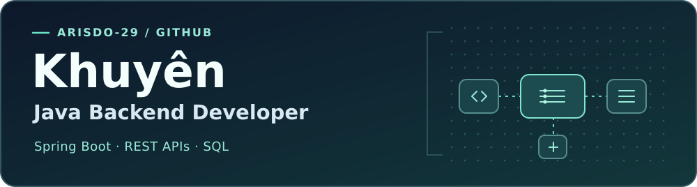

  

  

  
  
  
  
  

---

### ⚡ Về mình

Mình là **Khuyên**, một **Java Backend Developer** đam mê xây dựng các hệ thống dịch vụ backend vững chắc, luồng xử lý dữ liệu chuẩn chỉ và tối ưu hóa RESTful API.

- 🎯 **Trọng tâm hiện tại:** Phát triển ứng dụng chuyên sâu với **Java 21**, **Spring Boot**, và quản trị cơ sở dữ liệu quan hệ (**PostgreSQL / SQL Server**).
- 🤝 **Thế mạnh phối hợp:** Thường đảm nhiệm vai trò **Team Lead kiêm Backend 1** trong các dự án học tập/đồ án nhóm — vừa chịu trách nhiệm định hình kiến trúc, phân chia task, vừa trực tiếp phát triển các module cốt lõi (Core Business, Payment Gateway, DB Migration).
- 💡 **Phương châm:** *“Code sạch, kiến trúc rõ ràng, tính năng chạy ổn định và giải quyết đúng bài toán của người dùng.”*

---

### 🛠️ Kỹ năng & Công nghệ (Tech Stack)

<table>
  <tr>
    <td width="25%" align="right"><b>Backend Core</b></td>
    <td>
      
      
      
      
      
    </td>
  </tr>
  <tr>
    <td width="25%" align="right"><b>Database & Migration</b></td>
    <td>
      
      
      
    </td>
  </tr>
  <tr>
    <td width="25%" align="right"><b>Frontend & Template</b></td>
    <td>
      
      
      
      
    </td>
  </tr>
  <tr>
    <td width="25%" align="right"><b>Tools & DevOps</b></td>
    <td>
      
      
      
      
      
      
    </td>
  </tr>
</table>

---

### 🚀 Dự án nổi bật

<table width="100%">
  <tr>
    <td width="50%" valign="top">
      <h3 align="left">🔄 ShareLoop</h3>
      
<i>Nền tảng mạng xã hội - cộng đồng hỗ trợ chia sẻ, cho tặng và trao đổi đồ dùng cũ nhằm giảm thiểu lãng phí.</i>

      
<b>Vai trò:</b> Team Lead & Core Backend

      <ul>
        <li>Điều phối tiến độ đội ngũ và thiết lập cấu trúc mã nguồn chung.</li>
        <li>Tích hợp cổng thanh toán <b>VNPay Sandbox</b> cho luồng nạp Credit: mã hóa chữ ký số, xử lý redirect URL và IPN callback an toàn.</li>
        <li>Quản lý di chuyển lược đồ dữ liệu tự động với <b>Flyway</b> trên <b>PostgreSQL</b>.</li>
      </ul>
      

        
        
        
        
      

      

        🔗 <a href="https://github.com/arisdo-29/swp391_shareloop_team1_fa26"><b>Xem mã nguồn</b></a> · 
        📋 <a href="https://github.com/arisdo-29/swp391_shareloop_team1_fa26/issues/122"><b>Hạng mục VNPay (#122)</b></a>
      

    </td>
    <td width="50%" valign="top">
      <h3 align="left">🚤 Saigon Waterbus</h3>
      
<i>Ứng dụng web đặt vé buýt đường sông Sài Gòn, tối ưu quy trình tìm kiếm lộ trình và đặt chỗ trực tuyến.</i>

      
<b>Vai trò:</b> Backend & UI Module Owner

      <ul>
        <li>Xây dựng toàn bộ <b>Module Quản lý tuyến & Bến tàu</b> (lộ trình, lịch chạy, trạm đón trả).</li>
        <li>Phát triển luồng người dùng chính: Tìm kiếm chuyến, chọn ghế ngồi theo sơ đồ tàu, checkout và tra cứu vé đã đặt.</li>
        <li>Kết nối cơ sở dữ liệu quan hệ với <b>SQL Server</b> và render giao diện động với <b>Thymeleaf</b>.</li>
      </ul>
      

        
        
        
        
      

      

        🔗 <a href="https://github.com/arisdo-29/waterbus"><b>Xem mã nguồn</b></a>
      

    </td>
  </tr>
</table>

---

### 📊 Hoạt động GitHub (GitHub Activity & Stats)

  
  

  

---

  <i>✨ Cảm ơn bạn đã ghé thăm hồ sơ GitHub của mình! Hãy kết nối để cùng chia sẻ và phát triển nhé. ✨</i>
    
  

